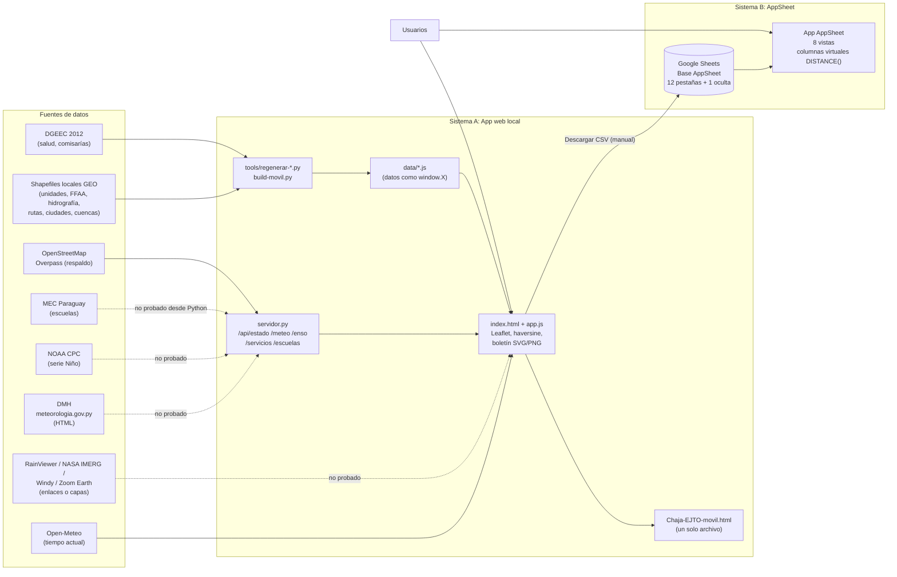
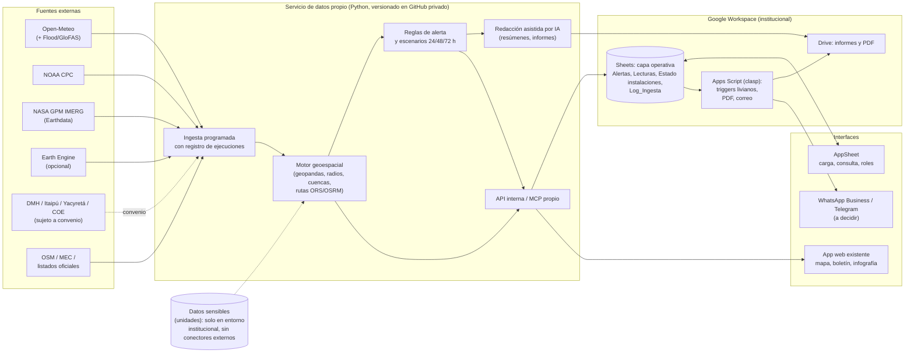

# Auditoría técnica — CHAJÁ–EJTO

Fecha: 20/10/2026 · Modalidad: solo lectura · Preparado para compartir con ChatGPT

## 0. Alcance y método (leer primero)

**Lo que se revisó realmente:**

| Fuente | Cómo se accedió | Qué se leyó |
|---|---|---|
| `CHECKPOINT-Chaja-EJTO_5.md` (Drive) | Conector Google Drive, lectura | Documento completo (es la mejor descripción del proyecto) |
| Hoja "Chajá-EJTO – Base AppSheet" | Conector Google Sheets, lectura | Nombres de pestañas, dimensiones y **solo la fila de encabezados** de cada una |
| Hoja "Chajá-EJTO · Datos AppSheet" (duplicada) | Ídem | Ídem |
| Listado de Drive | Búsqueda solo de metadatos | Existencia de `Chaja-EJTO-movil_N.html`, `Chaja-EJTO_N.zip` y `CHECKPOINT-*.md` (versiones 1 a 8) |
| Repositorio de esta sesión | Lectura local | `video-cuba-remotion`: es un proyecto Remotion de un video sobre Cuba, **sin relación con CHAJÁ–EJTO** |

**Lo que NO se pudo revisar:** el código fuente (`app.js`, `servidor.py`, `index.html`, `data/*.js`), el editor de AppSheet (vistas, bots, fórmulas, seguridad), cualquier proyecto de Apps Script, y las cuentas o claves de APIs. Los `.zip` y `.html` de Drive existen pero no se abrieron (3 MB y 1,8 MB; no hacía falta para un diagnóstico por encabezados y quedaba fuera de lo pedido).

**No se leyó ni se reproduce ningún dato de filas**: ni coordenadas, ni emails de la hoja Usuarios, ni ubicaciones de unidades. No se modificó nada.

**Convención de estados usada en todo el informe:**
- **CONFIRMADO**: visto directamente en esta sesión (hojas, encabezados, checkpoint).
- **DECLARADO**: afirmado en el checkpoint, que es documentación de otra sesión de IA; no lo verifiqué contra el código.
- **INFERIDO**: deducción razonable, no comprobada.
- **NO VERIFICADO**: no hay evidencia.

Hallazgo importante de contexto: **CHAJÁ–EJTO no es solo AppSheet.** Son dos sistemas que conviven (ver sección 2).

---

## 1. Resumen ejecutivo

1. CHAJÁ–EJTO tiene **dos componentes**: (A) una **app web local** (HTML/JS + servidor Python, también empaquetada como un único HTML móvil) que concentra casi toda la lógica útil, y (B) una **app AppSheet** sobre Google Sheets que es más reciente y todavía mínima.
2. **No hay Google Apps Script, ni webhooks, ni bots de AppSheet confirmados.** No se encontró ninguna evidencia de ellos. Las integraciones "vivas" están en el servidor Python local.
3. La parte geoespacial **ya existe en la app web**: distancia haversine, 3 recursos más cercanos por categoría, cuencas, ríos, rutas, ciudades, frontera y escuelas como posibles refugios. En AppSheet solo hay un primer intento con `DISTANCE()` en columnas virtuales de `Alertas`.
4. **Ninguna integración meteorológica en vivo ha sido probada** (DMH, ENOS/NOAA, RainViewer, IMERG, Windy). El entorno donde se programó no llegaba a esos sitios. Hoy la app muestra una lectura vieja del 9/10.
5. Claude Code, en esta sesión, **no tiene acceso directo al proyecto como tal**, pero sí a Google Drive y Sheets por conectores (con capacidad técnica de escritura, que no usé). No tiene acceso a AppSheet, Apps Script ni `clasp`.
6. Riesgos principales: datos de 2012 (salud y comisarías), coordenadas militares sensibles dentro de una hoja de Drive, hoja duplicada que puede confundir, un fallo previo que dejó la app AppSheet "no ejecutable" por una fórmula, y ausencia de control de versiones del proyecto (hay copias numeradas en Drive).
7. Recomendación: **no migrar la lógica a AppSheet.** Mantener el núcleo de cálculo en un servicio propio (el Python existente o uno nuevo) y usar AppSheet como interfaz de carga y consulta, alimentada por Sheets.

---

## 2. Arquitectura actual

### 2.1 Dos sistemas en paralelo

**Sistema A — App web "Chajá-EJTO" (DECLARADO por el checkpoint; no revisé el código).**
Sin framework ni compilación. HTML/JS puro con Leaflet 1.9.4 local. Servidor local en Python con biblioteca estándar. Cinco pestañas: Avisos, Pronóstico, Boletín, Monitoreo, Configuración. Se distribuye también como un solo HTML móvil con datos incrustados. Corre en la PC del dueño y puede abrirse en la red local. PWA (service worker, manifest).

**Sistema B — App AppSheet "Chajá-EJTO" (CONFIRMADO que la hoja existe y su estructura; DECLARADO que la app existe).**
Sobre la hoja de Drive "Chajá-EJTO – Base AppSheet". Vistas declaradas: Mapa, Unidades FFAA, Avisos, Salud, Comunidades indígenas, Distritos, Localidades, Policía. Columnas virtuales declaradas en `Alertas` para unidades, policía y salud cercanas.

### 2.2 Diagrama de la arquitectura actual

Las flechas punteadas indican integraciones **declaradas pero nunca probadas en vivo**. El paso de la app web a Sheets es **manual** (exportar CSV y cargar).

---

## 3. Inventario de componentes

| Componente | Estado | Evidencia |
|---|---|---|
| Google AppSheet (app) | Existe, mínima | DECLARADO (checkpoint). Editor no accesible |
| Google Sheets "Base AppSheet" | **CONFIRMADO** | 13 pestañas (1 oculta), leídas |
| Google Sheets duplicada "Datos AppSheet" | **CONFIRMADO** | 9 pestañas; no la usa la app. Contiene `Pronostico`, `ENOS`, `Enlaces`, que **no existen** en la hoja principal |
| Google Drive | **CONFIRMADO** | Carpeta con versiones `Chaja-EJTO_1…8.zip`, `Chaja-EJTO-movil_1…8.html`, `CHECKPOINT_1…5.md` |
| Google Apps Script | **NO VERIFICADO / sin evidencia** | Ni el checkpoint ni las hojas lo mencionan. Mi búsqueda en Drive de archivos Apps Script no devolvió ninguno en la primera página, pero el listado era parcial |
| APIs externas en uso | Ver sección 5 | Todas DECLARADAS, ninguna probada |
| Webhooks | **Ninguno encontrado** | |
| Bots de AppSheet / automatizaciones | **NO VERIFICADO** | Ninguna mencionada |
| Servidor propio | DECLARADO | `servidor.py`, puerto 8765, clave básica opcional por variable de entorno |
| Conectores MCP | Ver sección 6 | |
| Repositorio GitHub del proyecto | **No encontrado** | El repo de esta sesión no es de CHAJÁ–EJTO. El código vive en una PC local y en copias `.zip` en Drive |
| Control de versiones | Solo copias numeradas | INFERIDO por los nombres de archivo |

### Funciones operativas vs. pendientes

**Operativas (DECLARADO; algunas probadas con Playwright/Chromium según el checkpoint):**
- Avisos por departamento con mapa coloreado por nivel.
- Recursos cercanos (3 por categoría), distancia y rumbo.
- Capas de mapa: unidades, cuencas, comunidades, FFAA, comisarías, salud, ríos, rutas, frontera, ciudades, escuelas.
- Columna "Entorno": curso de agua, ruta y ciudad más cercanos, distancia a frontera (probado en navegador).
- Boletín: edición, infografía SVG/PNG, texto para WhatsApp.
- Exportación CSV para AppSheet.

**Declaradas pero sin prueba en vivo:** lectura DMH, `/api/enso`, `/api/escuelas` desde Python, RainViewer, IMERG, Windy.

**Pendientes (según el propio checkpoint):** mostrar las columnas virtuales en el detalle de Alertas de AppSheet y validarlas con el aviso de ejemplo; tabla Escuelas en AppSheet (la pestaña existe, ver 4.11); regla de crecida por cercanía a ríos; humedales y RAMSAR; rutas y tiempos (OSRM); exportar a PDF; notificaciones; completar 11 unidades con datos a revisar; reemplazar los listados de 2012.

---

## 4. Estructura de base de datos

Fuente: encabezados leídos de "Chajá-EJTO – Base AppSheet" (**CONFIRMADO**). Los **tipos de dato y la clave primaria** no están en la hoja; son del modelo de AppSheet, al que no tengo acceso. Los marco como INFERIDO. La cantidad de filas no se midió: las dimensiones de la hoja (`rowCount`) incluyen filas vacías.

Convención de AppSheet: la columna `Ubicacion` probablemente es de tipo **LatLong** (INFERIDO por nombre y por el uso de `DISTANCE()`).

### 4.1 `Alertas` — eventos y avisos
- **Columnas:** ID, Titulo, Tipo, Nivel, Departamentos, Emitida, Vigente_desde, Vigente_hasta, Descripcion, Indicaciones, Apoyo_personal, Apoyo_vehiculos, Unidades_apoyo, Estado, Emitida_por, Imagen, Es_ejemplo.
- **Clave:** `ID` (INFERIDO; el checkpoint cita el formato `EJ-0001`).
- **Relaciones (INFERIDO):** `Tipo` → TiposEvento; `Nivel` → Niveles; `Departamentos` → Departamentos (lista); `Unidades_apoyo` → Unidades (lista); `Emitida_por` → Usuarios.
- **Columnas virtuales declaradas (no visibles en la hoja, viven en AppSheet):** `Punto_ref` (LatLong, centro del primer departamento), `Unidades_cercanas`, `Policia_cercana`, `Salud_cercano` (EnumList de Ref, 3 más cercanas con `ORDERBY(SELECT(...), DISTANCE(...))`).
- **Coordenadas:** no propias; usa el centro del departamento.
- **Fuente:** carga manual; hay ejemplos marcados con `Es_ejemplo`.
- **Observación:** un primer intento con `LOOKUP([_THIS],…)` dejó la app no ejecutable hasta corregirlo (DECLARADO). Esto indica que los cambios en columnas virtuales pueden romper la app completa.

### 4.2 `Departamentos`
- Departamento, Codigo_INE, Capital, Ubicacion, Centro_geografico, Superficie_km2, Cant_distritos, Region.
- **Clave:** `Departamento` o `Codigo_INE` (INFERIDO). Coordenadas: `Ubicacion` y `Centro_geografico`. Fuente declarada: geoBoundaries ADM1 (CC BY 4.0) e INE 2022.

### 4.3 `Distritos`
- Codigo_INE, Distrito, Departamento, Ubicacion, Superficie_km2, Origen_ubicacion.
- Relación: Departamento → Departamentos. `Origen_ubicacion` indica cómo se obtuvo la coordenada (útil para calidad).

### 4.4 `Localidades`
- Clave, Barrio_localidad, Distrito, Departamento, Area, Ubicacion, Superficie_km2.
- Clave: `Clave` (campo explícito). Relaciones: Distrito, Departamento. Es la hoja más grande por dimensión (≈8.000 filas de capacidad).

### 4.5 `Unidades` — unidades militares (**SENSIBLE**)
- ID, Fuerza, Unidad, Ciudad, Direccion, Telefono, Departamento, Ubicacion, Coordenadas_verificadas, Observaciones.
- Clave: `ID`. Relación: Departamento. Coordenadas en `Ubicacion`, con el indicador `Coordenadas_verificadas`.
- Fuente declarada: shapefiles institucionales. Según el checkpoint, hay 11 unidades marcadas para revisión (departamento inconsistente, coordenadas ausentes o invertidas) y una con coordenadas fuera del país.
- **Riesgo:** esta hoja contiene teléfono, dirección y posición de unidades. Ver sección 7.
- Existe además una pestaña **oculta** `Respaldo_Unidades_20oct`, con las mismas columnas (respaldo previo a una modificación del 20/10).

### 4.6 `Niveles`
- Nivel, Orden, Color, Descripcion, Accion_Ejercito. Tabla de referencia de severidad. Clave: `Nivel`. Define la acción esperada del Ejército por nivel.

### 4.7 `TiposEvento`
- Tipo, Icono, Indicaciones_por_defecto. Tabla de referencia. Clave: `Tipo`.

### 4.8 `Usuarios` (datos personales)
- Email, Nombre, Grado, Rol, Unidad. Clave: `Email` (INFERIDO). Probable base de la seguridad por rol de AppSheet. No se leyeron filas.

### 4.9 `Salud` — puestos y centros de salud
- ID, Nombre, Distrito, Departamento, Ubicacion. Clave `ID`. Fuente declarada: DGEEC 2012 (≈1.600 filas). **Sin columnas de tipo de establecimiento, capacidad ni teléfono.**

### 4.10 `Policia` — comisarías
- ID, Nombre, Distrito, Departamento, Ubicacion. Fuente: DGEEC 2012 (≈1.080 filas). Misma limitación que Salud.

### 4.11 `ComunidadesIndigenas`
- ID, Comunidad, Aldea, Pueblo, Familia_linguistica, Distrito, Departamento, Ubicacion. Fuente original: **desconocida** (declarado por el checkpoint). Dimensión de hoja: 1.000 filas, pero el checkpoint habla de 778.

### 4.12 `Escuelas`
- ID, Codigo_MEC, Nombre, Departamento, Distrito, Localidad, Zona, **Capacidad**, Ubicacion, Fuente.
- La pestaña **ya existe** (8.000 filas de capacidad), aunque el checkpoint la lista como idea pendiente. NO VERIFICADO si contiene datos. `Capacidad` no existe en fuentes abiertas, según el checkpoint, así que probablemente está vacía.

### 4.13 Hoja duplicada "Datos AppSheet" (no usada por la app)
- Contiene `Alertas`, `Unidades`, `Departamentos`, `Niveles`, `Tipos_Evento` (con guion bajo, distinto de `TiposEvento`), `Usuarios`, y tres que **no existen** en la hoja principal: `Pronostico` (Ciudad, Dia, Minima, Maxima, Descripcion, Actualizado, Fuente), `ENOS` (Fecha_Informe, Estado, Nino34, Nino3, Nino12, Prob_SepNov, Prob_OctDic, Prob_NovEne, Resumen, URL, Proxima_Actualizacion), `Enlaces` (Nombre, Descripcion, URL).
- Esas tres son el germen de un monitoreo meteorológico dentro de AppSheet, hoy desconectado.

### 4.14 Observaciones transversales sobre el modelo
- No existe tabla de **resultados de proximidad** persistidos: se calculan al vuelo.
- No existe tabla de **estado de instalaciones** (disponibilidad, capacidad, contacto), clave para el uso humanitario.
- No existe tabla de **estaciones hidrométricas** ni de **lecturas de ríos**.
- No existe tabla de **registro de fuentes/ejecuciones** (qué se leyó, cuándo, con qué resultado).
- No hay **bitácora de cambios** de alertas.

---

## 5. Integraciones existentes

Todas **DECLARADAS** en el checkpoint. Ninguna verificada por mí.

| Integración | Dónde corre | Estado de prueba declarado |
|---|---|---|
| DMH — meteorologia.gov.py (lectura de páginas HTML con lista blanca) | `servidor.py` `/api/meteo` | **Nunca probada en vivo.** El analizador de texto es "aproximado". Lectura vieja del 9/10 en `data/meteo-lectura.js` |
| NOAA CPC — serie semanal Niño (archivo `wksst9120.for`) | `/api/enso` | **Nunca probada.** El formato del archivo es supuesto |
| Open-Meteo — "El tiempo ahora" | Navegador | Declarada como funcional; no hay mención de falla. NO VERIFICADO |
| OpenStreetMap Overpass (respaldo de servicios) | `/api/servicios`, caché 7 días | No probada en vivo |
| MEC (mapa de establecimientos + directorio CSV) | `/api/escuelas`, caché 30 días | Lógica probada con datos simulados y lectura desde el navegador del usuario (83 % de unión). **Descarga desde Python no probada** |
| RainViewer, NASA IMERG, Windy, Zoom Earth | Navegador (capas o enlaces) | No probadas |
| Mapas base: OpenStreetMap (solo http), Esri | Navegador | OSM solo por http: sin HTTPS no hay PWA offline en celular |
| Exportación CSV → AppSheet | Manual | Funcional según el checkpoint |

**No existen:** webhooks, WhatsApp automático (solo "texto para copiar"), correo, notificaciones push, ni sincronización automática entre la app web y Sheets.

---

## 6. Capacidades de Claude Code (esta sesión, evidencia propia)

| # | Pregunta | Respuesta |
|---|---|---|
| 1 | ¿Acceso directo al proyecto? | **No como proyecto.** El código (`app.js`, `servidor.py`) vive en una PC local y en `.zip` de Drive que no abrí. El repo montado en esta sesión es otro (video de Cuba). Sí accedo a la documentación (checkpoint) y a las hojas |
| 2 | ¿Consultar y modificar Sheets? | **Consultar: sí (probado).** **Modificar: técnicamente sí** (el conector expone actualizar valores, fórmulas, hojas), **pero no lo usé** por la restricción de solo lectura |
| 3 | ¿Apps Script? | **No.** No hay conector de Apps Script. El conector de Drive puede listar archivos, pero no edita ni ejecuta scripts |
| 4 | ¿Editor de AppSheet? | **No.** No hay conector ni API configurada. Las vistas, fórmulas, bots y seguridad solo se pueden ver desde el editor web, con intervención manual |
| 5 | ¿Crear o modificar bots? | **No.** Mismo motivo |
| 6 | ¿Consultar las tablas? | **Sí**, las pestañas de Google Sheets que respaldan las tablas. No consulto las tablas "vistas por AppSheet" (con columnas virtuales y filtros de seguridad) |
| 7 | ¿`clasp`? | **No instalado** (`which clasp` sin resultado) y sin credenciales (`~/.clasprc.json` no existe). Hay Node 22 y npm. Instalarlo estaba vetado en esta auditoría |
| 8 | ¿Conectores MCP? | Conectados: **Google Drive, Google Sheets, Google Docs, Google Slides, Gmail, Google Calendar, Canva**, y **GitHub** (acotado a un repo, que no es el del proyecto). **Microsoft 365: conexión incompleta.** Fallaron al conectar: Amplitude, Atlassian, Definite, Hex, BigQuery (errores de proxy/autenticación). **No hay conector de AppSheet, Apps Script ni de APIs meteorológicas** |
| 9 | ¿APIs configuradas? | **Ninguna** de las del proyecto (DMH, NOAA, Open-Meteo, etc.). No hay claves ni variables de entorno de ese tipo que yo haya visto. El entorno sale a internet por un proxy con restricciones |
| 10 | ¿Qué requiere intervención manual? | Todo lo de AppSheet (editor), aceptar avisos legales o cuentas (regla del propio checkpoint), ejecutar `servidor.py`/`build-movil.py` en la PC del dueño, subir y probar en vivo las lecturas de DMH/NOAA/MEC (mi entorno no las alcanza), y cargar CSV grandes |

### Permisos y herramientas para ampliar capacidades

1. **Google Cloud + Apps Script API + `clasp`**: proyecto de Apps Script vinculado, con `clasp login` hecho por el usuario y el script en un repo Git privado. Habilita desplegar y versionar.
2. **Cuenta de servicio o OAuth con alcance limitado** a Sheets y Drive (solo la carpeta del proyecto), en lugar del acceso amplio actual de los conectores a toda la cuenta.
3. **Repositorio GitHub privado** de CHAJÁ–EJTO (hoy no hay). Sin esto no hay historial, revisión ni CI. Debe ser privado por los datos sensibles.
4. **AppSheet**: no hay API de edición de la definición de la app. Opciones: la **API de AppSheet** (solo operaciones de datos sobre tablas, requiere clave de aplicación y plan que la incluya, NO VERIFICADO), o seguir editando a mano con guía de Claude.
5. **Acceso de red** del entorno a `meteorologia.gov.py`, NOAA y MEC para poder probar los lectores en lugar de depender de la PC del usuario.
6. Un **conector MCP de Google Sheets con lectura limitada a un rango** o una copia sanitizada sin datos militares, para que las IA externas trabajen sin ver coordenadas reales.

---

## 7. Limitaciones y riesgos identificados

**Seguridad y confidencialidad**
- La hoja `Unidades` (más el respaldo oculto) tiene posición, dirección y teléfono de unidades militares en una cuenta personal de Google. El propio checkpoint dice que no se deben subir a servicios públicos. Hoy están en Drive y son legibles por cualquier conector con acceso a la cuenta.
- La hoja `Usuarios` contiene emails y datos personales.
- Los conectores de esta sesión pueden leer todo Drive, incluidos archivos sin relación con el proyecto (la búsqueda mostró documentos de otro proyecto). Conviene aislar el proyecto en una carpeta o cuenta propia.
- `servidor.py` usa una clave básica opcional por variable de entorno y corre sin HTTPS: aceptable en LAN, insuficiente para exposición externa.

**Calidad de datos**
- Salud y comisarías son de **2012** y sin tipo ni capacidad. Escuelas: puntos de **2014**, directorio de 2023, 17 % sin coordenadas, sin capacidad.
- 11 unidades con datos a revisar; una con coordenadas fuera del país.
- Nombres con caracteres rotos de origen; ríos sin tildes.
- `Respaldo_Unidades_20oct` oculta y sin documentar en la app.

**Técnicas**
- Distancias en línea recta (haversine / `DISTANCE()`), **sin rutas ni tiempos**.
- Las columnas virtuales con `SELECT` + `ORDERBY` sobre tablas de miles de filas (Salud ≈1.600, Localidades ≈8.000, Escuelas) pueden volverse lentas en AppSheet. INFERIDO.
- Un error de expresión dejó la app AppSheet no ejecutable (precedente declarado). No hay entorno de pruebas (copia de la app) conocido.
- Las dos hojas con datos distintos y el mismo nombre base generan riesgo de editar la equivocada.
- Sin sincronización automática entre el sistema A y la hoja: la carga es manual por CSV, y el propio checkpoint admite que la hoja está desactualizada respecto del 9/10.
- Boletines, ENOS y pronóstico dependen de **lectura de HTML** de DMH y de carga manual del resumen ENOS: frágil ante cambios de sitio.
- Sin pruebas automatizadas conocidas; solo `node --check` y humo con jsdom.

**Operativas**
- Mantenimiento concentrado en una persona y una PC (`D:\...`). Sin respaldo formal más que los `.zip` numerados.
- Sin alertas hacia usuarios (push, correo, mensajería).

---

## 8. Fuentes meteorológicas e hidrológicas

**Aviso de verificación:** en esta auditoría **no consulté ninguna de estas fuentes en línea.** Lo que sigue es conocimiento general, con la fecha de corte de mi entrenamiento, y debe confirmarse antes de diseñar. Cuando no sé algo, lo marco NO VERIFICADO.

| Fuente | Acceso / API | Tipo de dato | Frecuencia | Formato | Autenticación | Costo / restricciones | Viabilidad con Apps Script |
|---|---|---|---|---|---|---|---|
| **DMH/DINAC** (`meteorologia.gov.py`) | **No conozco API pública documentada.** Hoy se lee HTML (scraping) | Pronóstico, avisos, boletines | Diaria (NO VERIFICADO) | HTML / PDF | Ninguna conocida | Sin términos de reuso verificados. Riesgo legal y técnico | `UrlFetchApp` puede leer HTML, pero frágil. **Mejor mantener el lector en el servidor** y escribir resultado a Sheets. Alternativa: pedir convenio o feed institucional |
| **NOAA/CPC** | Archivos públicos de texto/CSV (índices ONI, series Niño, boletín ENSO) | ENOS, índices semanales/mensuales, probabilidades | Semanal (Niño), mensual (diagnóstico, 2º jueves) | TXT, CSV, HTML, PDF | Ninguna | Gratis, dominio público de EE. UU. | **Alta**: archivos de texto simples con `UrlFetchApp` y un trigger programado. Validar el formato real (el de `wksst9120.for` es supuesto) |
| **NASA GPM / IMERG** | Vía NASA Earthdata (CMR, GES DISC, OPeNDAP); en Python, `earthaccess` | Precipitación satelital (aprox. 30 min a mensual) | 30 min (Early/Late), mejor calidad con latencia de meses | NetCDF / HDF5 / GeoTIFF; también capas WMS en Worldview | **Cuenta Earthdata gratuita (token)** | Gratis; archivos pesados | **Baja** en Apps Script (formatos científicos). Requiere procesamiento en Python y publicar un resumen (acumulados por cuenca/departamento) |
| **Open-Meteo** | API REST pública, y API de crecidas basada en GloFAS | Pronóstico horario/diario, histórico, precipitación, caudal modelado (NO VERIFICADO para ríos paraguayos concretos) | Horaria a diaria | JSON | Sin clave en uso gratuito | Gratuito para **uso no comercial** con límites; plan de pago para comercial. Verificar términos para uso institucional | **Alta**: JSON simple con `UrlFetchApp`. Es la fuente con mejor relación esfuerzo/valor |
| **Copernicus GloFAS** | Datos en Copernicus Emergency Management / Climate Data Store | Caudal modelado y pronóstico a ~30 días, alertas de crecida por punto de grilla | Diaria | GRIB2 / NetCDF | **Cuenta + token CDS** | Gratis con registro | **Baja** directo. Mejor vía Open-Meteo Flood API o servicio en Python |
| **Itaipú Binacional** | **NO VERIFICADO.** Publica datos hidrológicos en su web; no conozco API | Niveles del embalse, caudales, hidrometría del Paraná | Diaria (NO VERIFICADO) | HTML/PDF (NO VERIFICADO) | NO VERIFICADO | NO VERIFICADO | Scraping posible pero a confirmar; mejor solicitar un convenio |
| **Entidad Binacional Yacyretá** | **NO VERIFICADO.** Mismo caso | Niveles del embalse, caudal, cota | NO VERIFICADO | NO VERIFICADO | NO VERIFICADO | NO VERIFICADO | Ídem |
| **COE Ayolas** | **NO VERIFICADO.** No conozco fuente pública estructurada | Informes operativos, niveles en la zona | NO VERIFICADO | Posiblemente PDF/WhatsApp | NO VERIFICADO | NO VERIFICADO | Requiere acuerdo institucional o carga manual |

**Conclusión:** las fuentes **seguras y automatizables hoy** son Open-Meteo y NOAA/CPC. Las fuentes **paraguayas e hidroeléctricas** (DMH, Itaipú, Yacyretá, COE) son las más valiosas operativamente pero las menos conocidas técnicamente; el primer paso es **solicitar un canal oficial** (convenio, correo institucional, feed) en lugar de depender de scraping.

---

## 9. Análisis geoespacial

| Capacidad | Estado | Dónde |
|---|---|---|
| Distancia entre alerta e instalaciones | **Disponible** (línea recta) | App web: haversine con rumbo (DECLARADO). AppSheet: `DISTANCE()` en columnas virtuales (DECLARADO, pendiente de validar) |
| Recursos en radio configurable | **Parcial.** Hoy se muestran "las 3 más cercanas", no un radio | Requiere filtro por distancia y un parámetro; viable en ambos |
| Instalaciones cercanas en mapa | **Disponible** en app web; vista Mapa en AppSheet (DECLARADO) | |
| Rutas de acceso | **No disponible.** Solo capa de rutas principales como referencia visual | Desarrollo: OSRM u OpenRouteService |
| Zonas potencialmente inundables | **No disponible.** Hay ríos, cuencas y distancia al curso de agua más cercano, pero **sin modelo de inundación** ni humedales cargados | Desarrollo: humedales/RAMSAR, modelo de elevación, mapas de inundación históricos |
| Clasificar infraestructura por disponibilidad | **No disponible.** No existen campos de disponibilidad, capacidad ni estado | Desarrollo: modelo de datos nuevo y proceso de actualización |
| Reporte de recursos próximos a una emergencia | **Parcial.** El boletín incluye cantidades de unidades, comisarías y salud en la zona; no hay reporte detallado en PDF | Desarrollo |

Hay una trampa conceptual a evitar: "escuela cercana" no equivale a "refugio utilizable". Sin capacidad, estado del local, accesibilidad y probabilidad de anegamiento, la lista es solo un candidato.

---

## 10. Informes, infografías y prospectiva

| Producto | ¿Dentro de AppSheet/Apps Script? | ¿Servicio externo? |
|---|---|---|
| Informe meteorológico diario | **Sí, parcial**: Apps Script con trigger diario que lea Open-Meteo y escriba en Sheets; AppSheet muestra | DMH requeriría servidor o convenio |
| Reporte hidrológico | Parcial: datos puntuales por API | GloFAS/IMERG y Binacionales: procesamiento externo |
| Seguimiento ENOS | **Sí**: NOAA/CPC con trigger mensual/semanal; la pestaña `ENOS` ya está diseñada (en la hoja duplicada) | Resumen narrativo: IA |
| Resumen ejecutivo | Apps Script puede llamar a una API de IA y guardar el texto | Modelo de lenguaje (costo por uso) |
| Infografías | **Ya existe** en la app web (SVG/PNG). Apps Script/AppSheet no son un buen entorno gráfico | Mantener en la app web; o plantillas Canva (conector disponible) |
| PDF | Apps Script puede convertir un Google Doc/Slides a PDF | Aceptable; para maquetación compleja, servicio externo |
| WhatsApp | Texto para copiar ya existe | **Envío automático requiere WhatsApp Business API** (proveedor, costo, aprobación) o un bot de Telegram como alternativa más simple. NO VERIFICADO en detalle |
| Escenarios a 24/48/72 h | No como lógica de AppSheet | Modelo meteorológico (Open-Meteo/GFS) + reglas + IA que redacte; el escenario es un **cálculo y un texto**, ambos mejor en servicio externo con registro de supuestos |

---

## 11. Repositorios GitHub evaluados

Valoración sin haber consultado los repos ahora; descripción desde conocimiento general. NO VERIFICADO el estado de mantenimiento actual.

| Repositorio | Tipo | ¿Aporta capacidad real? | Comentario |
|---|---|---|---|
| `google/clasp` | Herramienta de desarrollo | **Sí, alto** | Permite versionar y desplegar Apps Script desde Git. Habilita CI. Requiere login interactivo del usuario |
| `open-meteo/open-meteo` | **API** (código abierto del servicio; se puede autoalojar) | **Sí, alto** | Usar el API alojado. Autoalojar solo si hay requisito de soberanía de datos |
| `earthaccess-dev/earthaccess` | Biblioteca Python | **Sí, medio** | Acceso a NASA IMERG/GPM. Útil si hay un servicio Python. No corre en Apps Script |
| `google/earthengine-api` | Biblioteca (Python/JS) sobre servicio de Google | **Sí, medio-alto** | Acceso a CHIRPS, GPM, Sentinel, JRC Surface Water, DEM sin descargar datos. Requiere proyecto Google Cloud registrado (uso no comercial gratuito, verificar condiciones). Muy útil para zonas inundables |
| `geopandas/geopandas` | Biblioteca Python | **Sí, medio** | Reemplaza `pyshp`+`shapely`+`pyproj` del actual `regenerar-datos.py`. Aporta unión espacial y buffers |
| `GIScience/openrouteservice-py` | Cliente Python de una API | **Sí, medio** | Rutas, isócronas. Necesita clave o instancia propia; límites del plan gratuito. Alternativa: OSRM |
| `Leaflet/Leaflet` | Biblioteca JS | **Ya en uso** (1.9.4 local) | Sin aporte nuevo, solo mantener |
| `plotly/plotly.js` | Biblioteca JS | **Bajo-medio** | Útil para series (Niño 3.4, caudales). Pesada; se puede resolver con SVG propio, como ya se hace |
| `modelcontextprotocol/servers` | **Servidores MCP** de referencia | **Indirecto** | Sirve de plantilla. Para este proyecto lo valioso sería **un servidor MCP propio** de CHAJÁ–EJTO (consulta de recursos y alertas) y no usar los genéricos |

Clasificación: **APIs/servicios** (Open-Meteo, Earth Engine, ORS) · **bibliotecas** (geopandas, earthaccess, Leaflet, Plotly) · **herramientas de desarrollo** (clasp) · **servidores MCP** (modelcontextprotocol/servers).

---

## 12. Propuesta de arquitectura futura

Principios: (1) **no tocar lo que funciona** (la app web y la hoja actual quedan intactas hasta tener reemplazo probado), (2) **un solo lugar de verdad** para cada dato, (3) lo sensible no sale del entorno institucional, (4) cada fuente externa queda registrada con fecha, resultado y error.

Decisiones de diseño clave:
- **AppSheet = interfaz**, no motor de cálculo. Las columnas virtuales con `SELECT/ORDERBY` sobre miles de filas son frágiles; mejor persistir resultados de proximidad calculados por el servicio.
- **Apps Script = pegamento liviano** (triggers, PDF, correo), versionado con `clasp`.
- **Datos militares** separados: una hoja o base distinta, con acceso restringido, y una versión sanitizada para desarrollo con IA externa.
- **Servidor MCP propio** (opcional, fase 3) para que Claude/ChatGPT consulten alertas y recursos sin acceso a las hojas completas.

---

## 13. Plan de implementación priorizado

Los costos son órdenes de magnitud **estimados, no cotizados**. Los costos de mano de obra no se incluyen.

### Paso 0 — Higiene previa (1 a 3 días, sin costo)
1. Crear **repositorio GitHub privado** y subir el código (sin `data/` sensible).
2. Decidir cuál hoja es la oficial y archivar o marcar la duplicada; migrar `Pronostico`, `ENOS`, `Enlaces` si se van a usar.
3. Duplicar la app AppSheet como **entorno de pruebas** antes de tocar fórmulas.
4. Revisar quién tiene acceso a `Unidades` y `Usuarios`; separar o proteger.
5. Probar en la PC del usuario las lecturas nunca verificadas (DMH, NOAA, MEC) y anotar el resultado.

### Fase 1 — Integración de datos
- **Funcionalidades:** ingesta programada de Open-Meteo (pronóstico por departamento), NOAA/CPC (ENOS), caudales modelados (Open-Meteo Flood o GloFAS); tabla `Lecturas` y `Log_Ingesta`; alertas semiautomáticas por umbral que un humano valida antes de emitir; pestañas `Pronostico` y `ENOS` en la hoja oficial; lectura DMH solo si se arregla el lector o se obtiene un canal oficial.
- **Herramientas:** Apps Script + `clasp` para lo liviano, o el servidor Python existente con `cron`; Sheets como destino.
- **Complejidad:** media-baja.
- **Costo estimado:** USD 0 (planes gratuitos, uso no comercial a verificar). Si Open-Meteo exige plan comercial por uso institucional: del orden de decenas de USD/mes, NO VERIFICADO.
- **Dependencias:** repo y `clasp` configurados; confirmar términos de uso de cada API; acceso de red probado.
- **Riesgos:** scraping de DMH roto sin aviso; cuotas de `UrlFetchApp` (límites diarios de Apps Script); fuentes binacionales sin canal oficial; falsos positivos de umbrales.

### Fase 2 — Inteligencia geoespacial
- **Funcionalidades:** radio configurable en lugar de "las 3 más cercanas"; persistir proximidad por alerta; estados de instalación (disponible, no disponible, capacidad, contacto, fecha de verificación); actualización de listados de salud y comisarías con fuentes vigentes; regla de crecida por cercanía a ríos y humedales; rutas y tiempos con OSRM/ORS; capa de zonas inundables (humedales, RAMSAR, y opcionalmente Earth Engine/JRC Surface Water); reporte de recursos próximos en PDF.
- **Herramientas:** `geopandas`, OSRM u OpenRouteService, Leaflet (ya está), Earth Engine (opcional).
- **Complejidad:** media-alta (la modelación de zonas inundables es la parte más difícil; empezar con proxys simples).
- **Costo estimado:** USD 0 a pocas decenas/mes (hosting liviano para OSRM u ORS propios, o planes de pago si se usa el servicio público con más volumen).
- **Dependencias:** Fase 1 estable; datos vigentes de Salud y Policía (requieren gestión institucional); definición de qué es "disponible" para un refugio.
- **Riesgos:** datos desactualizados que den falsa seguridad; distancia en línea recta confundida con tiempo de llegada; límites de plan gratuito de ORS; aceptación del aviso legal de visores de terceros (lo debe hacer el usuario).

### Fase 3 — IA y prospectiva
- **Funcionalidades:** resumen ejecutivo diario redactado con IA a partir de datos ya validados; escenarios 24/48/72 h (reglas + modelo, con supuestos visibles); informes PDF e infografías automáticas; envío por mensajería; opcionalmente servidor MCP propio.
- **Herramientas:** API de un modelo de lenguaje, plantillas de documento/PDF, Canva (conector disponible) para infografías institucionales, WhatsApp Business API o Telegram.
- **Complejidad:** media (la parte difícil es la validación, no la generación).
- **Costo estimado:** del orden de pocos USD a decenas de USD/mes por uso de API de IA; WhatsApp Business con costo por conversación y proveedor (NO VERIFICADO).
- **Dependencias:** Fases 1 y 2; política institucional sobre qué datos pueden enviarse a un modelo externo (nada de ubicaciones de unidades).
- **Riesgos:** **la IA puede redactar con seguridad algo falso**; un escenario mal calibrado en emergencia tiene consecuencias reales. Exigir revisión humana y mostrar fuente y hora de cada dato; envío de información militar a servicios externos; dependencia de proveedores.

### Orden recomendado
Paso 0 → Fase 1 (empezando por Open-Meteo y NOAA, que son las más seguras) → pruebas de DMH → Fase 2 (primero estado de instalaciones y radio, después rutas y zonas inundables) → Fase 3 (informes antes que escenarios).

---

## 14. Preguntas abiertas para el responsable del proyecto

1. ¿Existe algún proyecto de Apps Script o bot de AppSheet que no aparezca en la documentación?
2. ¿Dónde está hoy el código fuente completo y quién tiene copia?
3. ¿Cuál es la política institucional sobre alojar datos de unidades en cuentas personales de Google y sobre enviarlos a servicios de IA?
4. ¿Hay acuerdo o contacto con DMH, Itaipú, Yacyretá o el COE Ayolas para recibir datos?
5. ¿El uso será estrictamente interno y no comercial? Afecta los términos de Open-Meteo y Earth Engine.
6. ¿Quién valida una alerta antes de emitirla?

---

## 15. Anexo: lo que sigue sin verificar

- Todo el código del Sistema A y su comportamiento real.
- Vistas, fórmulas, seguridad, bots y plan de la app AppSheet.
- Tipos de columna, claves y relaciones reales (aquí inferidos).
- Cantidad real de filas en cada tabla.
- Contenido de la pestaña `Escuelas` y de los `.zip`/`.html` de Drive.
- Todas las APIs externas y sus términos de uso vigentes.
- Si existen proyectos de Apps Script en la cuenta.
